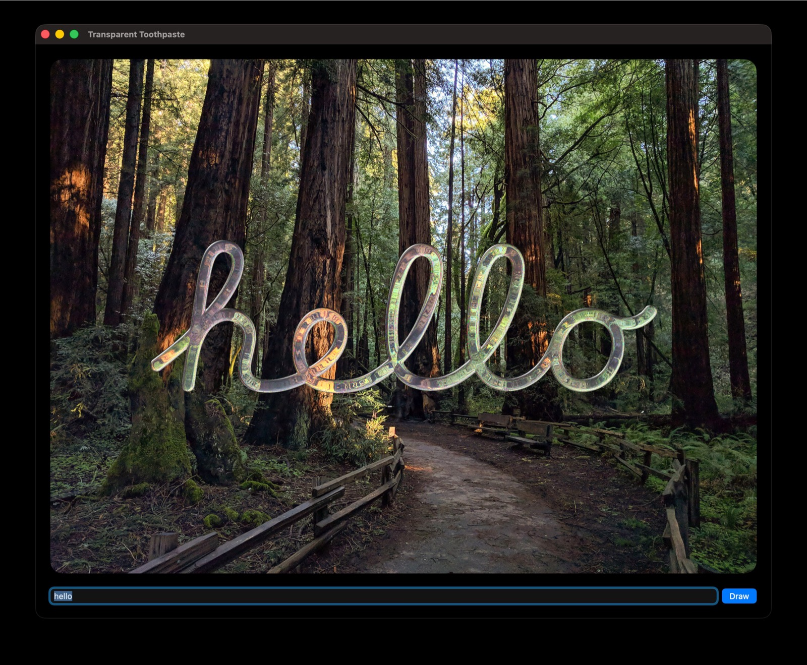

# Transparent Toothpaste

Transparent Toothpaste is a small macOS app that animates text with Apple's Macintosh Skeletal font.

## What you need

- macOS 27 and a Mac with Metal support
- Xcode 27
- **Macintosh Skeletal** (`MacintoshSkeletal.otf`) and the compiled Metal shader library (`default.metallib`) on your Mac, or local copies

## License

[WTFPL, version 2](LICENSE)
 [Muir Woods photograph](https://commons.wikimedia.org/wiki/File:Muir_Woods_National_Monument_(47879029461).jpg) by Matthew Dillon [CC BY 2.0](https://creativecommons.org/licenses/by/2.0/)
